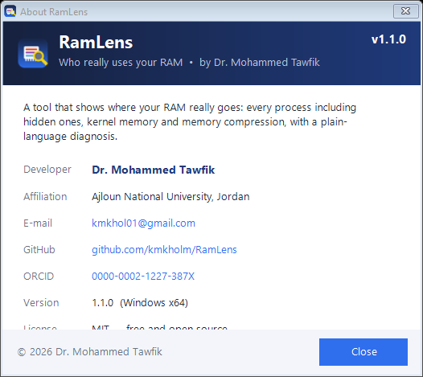

<p align="center"></p>

<h1 align="center">RamLens</h1>
<p align="center"><b>Who really uses your RAM — accurate memory accounting for Windows</b><br>
<b>من يستهلك الرام فعلاً — محاسبة دقيقة لذاكرة ويندوز</b></p>

<p align="center">
<a href="../../releases/latest"></a>


</p>

<p align="center"><a href="#english">English</a> · <a href="#العربية">العربية</a></p>


## English

### Why Task Manager is not enough
Task Manager's *Memory* column shows only the **private working set** of each process. It leaves out:
- kernel memory (paged / non-paged pool, system cache, drivers),
- shared pages (DLLs, mapped files),
- memory locked by drivers (GPU, Hyper-V/VBS, VMware/VirtualBox, RAM disks),
- the hidden **Memory Compression** process.

As a result, the column total is often 10+ GB below *In use*, and the missing memory looks like a leak.

### What RamLens shows
- **Every process, hidden ones included.** Data is read directly from the kernel with `NtQuerySystemInformation(SystemProcessInformation)`, so you also see Memory Compression, Secure System, Registry, `vmmem` (WSL2/Docker) and every service host. No admin rights are needed for the memory figures.
- **Where "In use" goes.** It is split into process private memory, memory compression, virtual machines, the Windows kernel (pools + cache + drivers) and *unattributed* memory (shared, page tables or driver-locked). A colour bar also shows Modified, Standby and Free; hover over it for exact values.
- **Standby explained.** Standby is file cache that Windows releases instantly when a program needs memory. Real available memory = Standby + Free.
- **Grouping by program.** For example, all 25 `brave.exe` processes appear as one row. In-cell bars show the private memory, and each process is labelled *app / hidden background / service / system / VM*. The services inside each `svchost.exe` are listed.
- **Kernel pool tags,** as in `poolmon`. Double-click a tag and RamLens searches `System32\drivers\*.sys` for the driver that owns it, which helps track down driver memory leaks.
- **Plain-language diagnosis.** A tab explains the current numbers and warns about driver leaks, large compression or VM memory, and driver-locked memory.
- **Menus and shortcuts:** File, View, Tools and Help, plus F5 refresh, Ctrl+G grouping, Ctrl+L language, a refresh interval of 2–30 s, CSV export, a text report, *end process* (with confirmation) and *open file location*.

### Download
Get `RamLens.exe` from **[Releases](../../releases/latest)** and run it. It is one portable file (Windows 10/11 x64, .NET Framework 4.x, which is built into Windows). Optional: restart it as administrator to see the full paths of elevated processes.

### Command line
```
RamLens.exe                                     start the GUI (remembers the last language)
RamLens.exe /en   |   RamLens.exe /ar           English / Arabic UI
RamLens.exe /report out.txt [/en|/ar] [/quiet]  write a text report, open it in Notepad (unless /quiet), exit
```

### Build from source
No SDK download is needed. It uses the C# compiler that ships with Windows:
```
build.cmd
```

---

## العربية


### لماذا لا يكفي مدير المهام؟
عمود «الذاكرة» في مدير المهام يعرض **الذاكرة الخاصة** لكل عملية فقط. لا يعرض ذاكرة نواة ويندوز، ولا الصفحات المشتركة، ولا الذاكرة التي تقفلها التعريفات، ويخفي عملية **Memory Compression**. لذلك يكون مجموع العمود أقل من «قيد الاستخدام» بأكثر من 10 GB أحياناً، فيبدو أن الذاكرة تتسرّب.

### ماذا يعرض RamLens؟
- **كل العمليات، ومنها المخفية:** يقرأ البيانات من النواة مباشرة، فيعرض Memory Compression و Secure System و vmmem وكل الخدمات، بدون صلاحيات مسؤول.
- **توزيع «المستخدمة فعلياً»:** ذاكرة البرامج الخاصة، وضغط الذاكرة، والآلات الافتراضية، ونواة ويندوز، والذاكرة غير المنسوبة لأي عملية (مشتركة أو مقفلة). مرّر الفأرة على الشريط الملوّن لترى القيمة الدقيقة.
- **شرح Standby:** هي ذاكرة مؤقتة يحرّرها ويندوز فوراً عند الحاجة. المتاح الحقيقي = Standby + الحرّة.
- **التجميع حسب البرنامج،** مع أشرطة داخل الجدول، وتصنيف ملوّن لكل عملية: تطبيق، أو خلفية مخفية، أو خدمة، أو نظام، أو آلة افتراضية.
- **ذاكرة النواة (Pool tags):** انقر مرتين على أي وسم ليبحث البرنامج عن ملف التعريف المسؤول عنه، وهذا يفيد في كشف تسرّب الذاكرة من التعريفات.
- **قوائم واختصارات:** ملف، وعرض، وأدوات، ومساعدة، مع F5 للتحديث، و Ctrl+G للتجميع، و Ctrl+L لتبديل اللغة، وتحديد فترة التحديث. وفيه أيضاً تصدير CSV، وتقرير نصّي، وإنهاء العمليات بعد التأكيد.

### التشغيل
حمّل `RamLens.exe` من صفحة **[Releases](../../releases/latest)** وشغّله مباشرة، فلا يحتاج إلى تثبيت.
زر «English / العربية» داخل البرنامج يبدّل اللغة.

---

## Developer · المطوّر

**Dr. Mohammed Tawfik — د. محمد توفيق**
Ajloun National University, Jordan — جامعة عجلون الوطنية، الأردن
✉ kmkhol01@gmail.com · [GitHub @kmkholm](https://github.com/kmkholm) · [ORCID 0000-0002-1227-387X](https://orcid.org/0000-0002-1227-387X)



Suggestions and bug reports are welcome in [Issues](../../issues).

MIT License © 2026 Mohammed Tawfik
