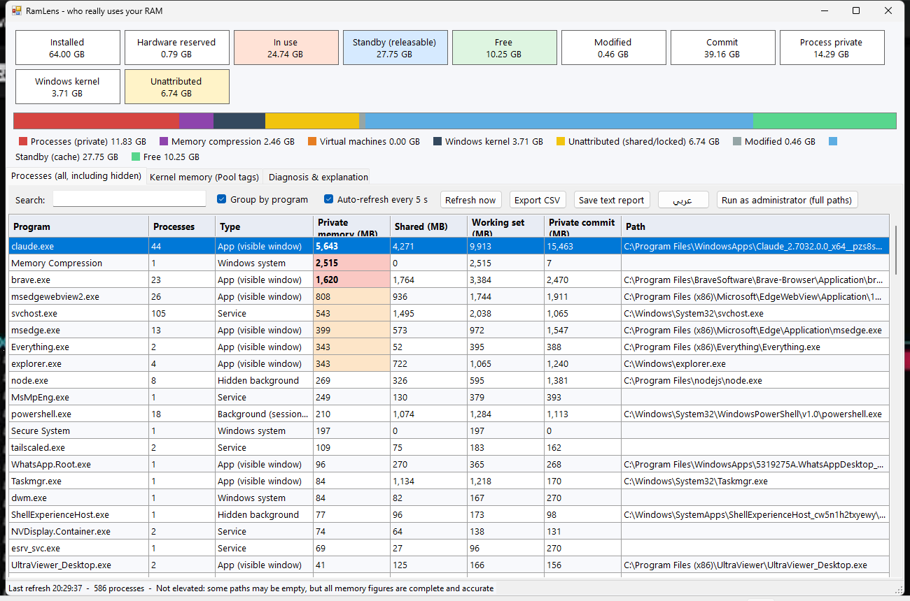
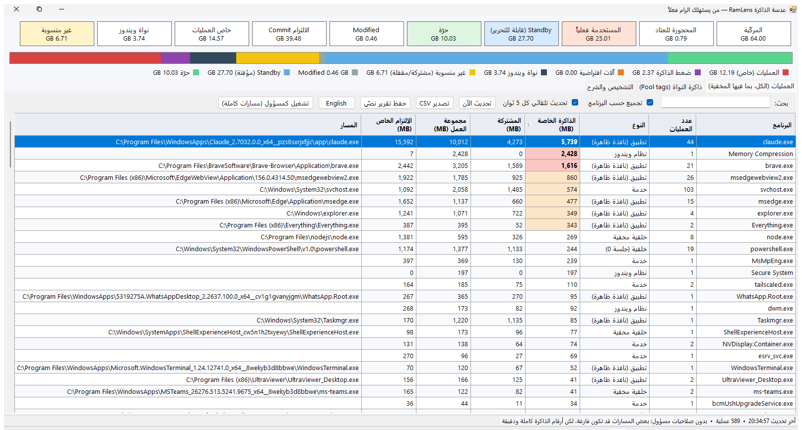

# RamLens — who really uses your RAM

**[English](#english) | [العربية](#العربية)**

RamLens is a small Windows tool that shows where your physical memory actually goes. Task Manager doesn't show this.
It is one portable EXE (about 60 KB) with nothing to install, and the interface is in Arabic and English.



## English

### Why Task Manager is not enough
Task Manager's *Memory* column shows only the **private working set** of each process. It leaves out:
- kernel memory (paged / non-paged pool, system cache, drivers),
- shared pages (DLLs, mapped files),
- memory locked by drivers (GPU, Hyper-V/VBS, VMware/VirtualBox, RAM disks),
- the hidden **Memory Compression** process.

As a result, the column total is often 10+ GB below *In use*, and the missing memory looks like a leak.

### What RamLens shows
- **Every process, hidden ones included.** Data is read directly from the kernel with `NtQuerySystemInformation(SystemProcessInformation)`, so you also see Memory Compression, Secure System, Registry, `vmmem` (WSL2/Docker) and every service host. No admin rights are needed for the memory figures.
- **Where "In use" goes.** It is split into process private memory, memory compression, virtual machines, the Windows kernel (pools + cache + drivers) and *unattributed* memory (shared, page tables or driver-locked). A colour bar also shows Modified, Standby and Free.
- **Standby explained.** Standby is file cache that Windows releases instantly when a program needs memory. Real available memory = Standby + Free.
- **Grouping by program.** For example, all 25 `brave.exe` processes appear as one row. Each process is labelled *app / hidden background / service / system / VM*, and the services inside each `svchost.exe` are listed.
- **Kernel pool tags,** as in `poolmon`. Double-click a tag and RamLens searches `System32\drivers\*.sys` for the driver that owns it, which helps track down driver memory leaks.
- **Plain-language diagnosis.** A tab explains the current numbers and warns about driver leaks, large compression or VM memory, and driver-locked memory.
- CSV export, a text report, auto-refresh, search, *end process* (with confirmation) and *open file location*.

### Download
Get `RamLens.exe` from **[Releases](../../releases)** and run it (Windows 10/11 x64, .NET Framework 4.x, which is built into Windows).

Optional: run as administrator to see the full paths of elevated processes.

### Command line
```
RamLens.exe            start the GUI (remembers the last language)
RamLens.exe /en        English UI
RamLens.exe /ar        Arabic UI
RamLens.exe /report out.txt [/en|/ar] [/quiet]   write a text report, open it in Notepad (unless /quiet), exit
```

### Build from source
No SDK download is needed. It uses the C# compiler that ships with Windows:
```
build.cmd
```

---

## العربية



### لماذا لا يكفي مدير المهام؟
عمود «الذاكرة» في مدير المهام يعرض **الذاكرة الخاصة** لكل عملية فقط. لا يعرض ذاكرة نواة ويندوز، ولا الصفحات المشتركة، ولا الذاكرة التي تقفلها التعريفات، ويخفي عملية **Memory Compression**. لذلك يكون مجموع العمود أقل من «قيد الاستخدام» بأكثر من 10 GB أحياناً، فيبدو أن الذاكرة تتسرّب.

### ماذا يعرض RamLens؟
- **كل العمليات، ومنها المخفية:** يقرأ البيانات من النواة مباشرة، فيعرض Memory Compression و Secure System و vmmem وكل الخدمات، بدون صلاحيات مسؤول.
- **توزيع «المستخدمة فعلياً»:** ذاكرة البرامج الخاصة، وضغط الذاكرة، والآلات الافتراضية، ونواة ويندوز، والذاكرة غير المنسوبة لأي عملية (مشتركة أو مقفلة).
- **شرح Standby:** هي ذاكرة مؤقتة يحرّرها ويندوز فوراً عند الحاجة. المتاح الحقيقي = Standby + الحرّة.
- **التجميع حسب البرنامج** وتصنيف كل عملية: تطبيق، أو خلفية مخفية، أو خدمة، أو نظام، أو آلة افتراضية.
- **ذاكرة النواة (Pool tags):** انقر مرتين على أي وسم ليبحث البرنامج عن ملف التعريف المسؤول عنه، وهذا يفيد في كشف تسرّب الذاكرة من التعريفات.
- **تشخيص بلغة واضحة**، وتصدير CSV، وتقرير نصّي، وتحديث تلقائي، وبحث، وإنهاء العمليات بعد التأكيد.

### التشغيل
حمّل `RamLens.exe` من صفحة **[Releases](../../releases)** وشغّله مباشرة، فلا يحتاج إلى تثبيت.
زر «English / عربي» داخل البرنامج يبدّل اللغة.

---

MIT License © Mohammed Tawfik
